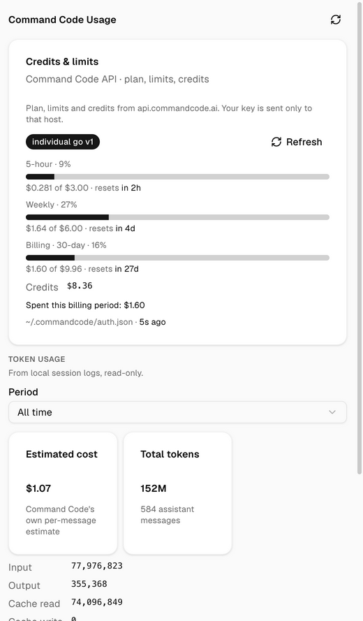

# Command Code Usage for Orca

An Orca plugin for Command Code (`command-code` / `cmd`) usage. Its primary block is the
Command Code API: plan, 5-hour / weekly / billing-period limits and remaining credits. Below it,
the plugin shows token and cost usage from the local session logs, broken down by day, project and
model, plus a status bar item for today.

Orca's built-in **Settings → Stats & usage** tracks Claude Code, Codex, OpenCode and Muse only.
Command Code is a recognised launchable agent in Orca, but its sessions are never scanned there,
so its usage is invisible. This plugin closes that gap.



## What it shows

The panel is ordered with the API data first:

- **Credits & limits** (top) — the plan, the 5-hour / weekly / billing-period bars, remaining
  credits (monthly + purchased + free) and spend in the billing period.
- **Token usage** (below) — period selector (Today, 7 days, 30 days, All time), total tokens and
  total estimated cost, with input, output, cache read and cache write broken out separately.
  Days are local calendar days; "7 days" is today plus the previous six.
- **Three breakdown tables** — by day, by project and by model. Each row shows input, output,
  cache-read, cache-write, total tokens and cost. The per-table token columns collapse on a narrow
  sidebar (`In`/`Out` at 360 px, `Cache R`/`Cache W` at 480 px); the breakdown above the tables
  always shows all four token kinds.
- **Status bar item** — today's cost and token total, e.g. `CC $0.499 · 72.4M`, refreshed when the
  worker starts and every five minutes while Orca stays open. Hover shows the exact numbers.

Projects are the `<slug>` names Command Code uses on disk (`users-me-project-name`). The worker
recovers the real path from Orca's workspace list when the project is one of your workspaces, and
otherwise probes the filesystem for a matching path, so the tables read like
`~/Documents/Programming/Project/orca-command-code`. When no real path can be found the raw slug
is shown.

## Credits & limits (always on)

The top block queries the API whenever the panel opens. There is no toggle: if a key resolves, the
four API calls are made; if none resolves, no request is sent and the block asks for a key.

The worker resolves a key in this order, the same as the Paseo
`paseo-commandcode-usage` plugin and the pi provider:

1. Orca's encrypted plugin secrets (paste a key into the panel; **Forget key** removes it)
2. `COMMAND_CODE_API_KEY`, then `COMMANDCODE_API_KEY`
3. `~/.commandcode/auth.json`, then `~/.pi/agent/auth.json`, then `~/.omp/agent/auth.json`

and calls only `api.commandcode.ai`:

| Endpoint | Used for |
| --- | --- |
| `/alpha/whoami` | account label, `org.id` |
| `/alpha/billing/credits` | monthly/purchased/free credits, 5-hour and weekly `{ used, cap, resetAt }` |
| `/alpha/billing/subscriptions` | plan, billing-period start/end |
| `/alpha/usage/summary` | spend in the billing period |

Sections the API does not report are omitted, never zeroed. 401/403 becomes "API key rejected", an
expired stored login asks for a fresh key, and the whole call gives up after 15 seconds instead of
hanging the panel. The key is sent only to that host, never logged, never posted to a panel and
never included in the UI; error bodies pass through a credential redactor first.

## Data source

Command Code writes one JSON object per line to:

```
~/.commandcode/projects/<slug>/<session-id>.jsonl
~/.commandcode/projects/<slug>/<session-id>.checkpoints.jsonl   # skipped entirely
```

Assistant entries carry `timestamp`, `model` and
`usage { inputTokens, outputTokens, cacheReadTokens, cacheWriteTokens, costUsd }`. `costUsd` is
already computed by Command Code per assistant message, so this plugin needs no price table; the
total is simply the sum. Total tokens is input + output + cache read + cache write. The verified
shape is documented in [docs/cc-session-format.md](docs/cc-session-format.md).

## Read-only guarantee

The usage scan (always on) is strictly local and read-only:

- Reads only `*.jsonl` files under `~/.commandcode/projects` (and never the `*.checkpoints.jsonl`
  files). It never reads `auth.json`, `settings.json`, `config.json` or the session metadata.
- Never writes anything to `~/.commandcode`, and makes no network calls.
- Streams each session file line by line, one file at a time, so a large history never has to fit
  in memory.
- Degrades instead of throwing: a missing `~/.commandcode/projects`, an empty projects folder, a
  partially written last line, unreadable files and unknown entry shapes all render as ordinary UI
  (an explanatory callout, an empty state, or a skipped-line count).

The credits block (always on) is the only part that reads a credential or leaves the machine:

- Runs when the panel opens and reads a key only from the places listed above.
- Sends the key only to `api.commandcode.ai`, never redeems refresh tokens and never writes to any
  credential store.
- Redacts credential-shaped text from every error before it reaches the panel or the logs.

Without a resolvable key the panel still works: it asks for one and makes no network request. The
usage scan and status bar never depend on the API.

The access it asks for is `workspace:read` (workspace names and paths, to prettify project slugs)
and `secrets:own` (store a pasted key encrypted at rest in Orca). The worker runs out of process
with your user account, as any `trusted-worker` plugin does.

## Install

Requires Orca 1.4.248 or newer.

```sh
orca plugin install /Users/agung.pratama/Documents/Programming/Project/orca-command-code \
  --approve <fingerprint>
```

Orca prints the fingerprint when the install needs approval:

```sh
orca plugin install <path> --json      # error.data.approvalFingerprint
orca plugin inspect <path> --json      # what it contributes and the access it asks for
```

Approve only the fingerprint Orca prints for exactly these files and this access. Any code change
produces a new fingerprint.

For development, load the folder instead of installing it:

```sh
orca plugin dev load <path> --json                       # prints its --approve fingerprint
orca plugin open local.command-code-usage --panel command-code-usage
orca plugin shot local.command-code-usage --panel command-code-usage
```

## Development

No build step: Orca loads the TypeScript and TSX as written.

```sh
orca plugin test .     # node:test suite for the scanner, formatters, panel and worker
orca plugin check .    # renders each panel.check.ts scenario against a stand-in host
orca plugin types .    # writes .orca/types for editor type checking (gitignored)
npx -p typescript tsc -p .   # optional strict type check
```

Layout:

| File | Purpose |
| --- | --- |
| `orca-plugin.json` | Manifest: panel, status bar item, settings, `trusted-worker`, capabilities |
| `src/worker.ts` | Worker: request handlers, status bar updates, project labels |
| `src/usage.ts` | Streaming scanner and day/project/model aggregation |
| `src/credits.ts` | Optional Command Code API client, credential resolution and redaction |
| `src/shared.ts` | Types and pure helpers shared with the sandboxed panel (no Node imports) |
| `src/projects.ts` | Lossy slug → real path recovery |
| `src/panel.tsx` | The components panel |
| `src/protocol.ts` | Typed panel ↔ worker contract |

## Limits

- Cost and tokens are only as accurate as Command Code's own per-message `usage` record; entries
  that are not assistant messages contribute nothing.
- "All time" re-reads every session file on each refresh. Scans are sequential and streamed, and a
  panel request that Orca stops waiting for is aborted, but a very large history still takes a
  moment.
- Credits are fetched on demand, not cached; each refresh makes the four API calls again, with a
  15-second overall timeout.

## License

MIT
